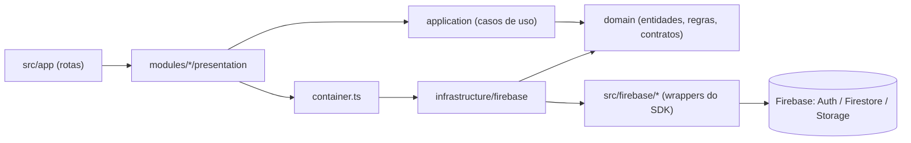
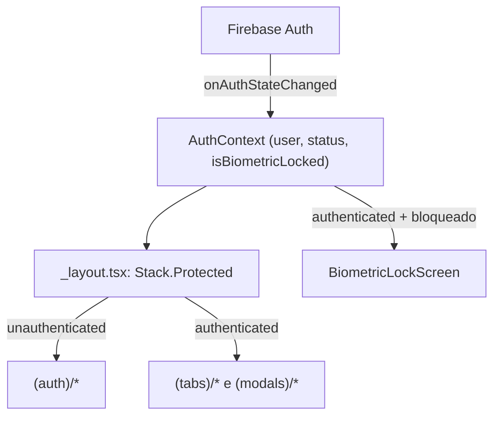
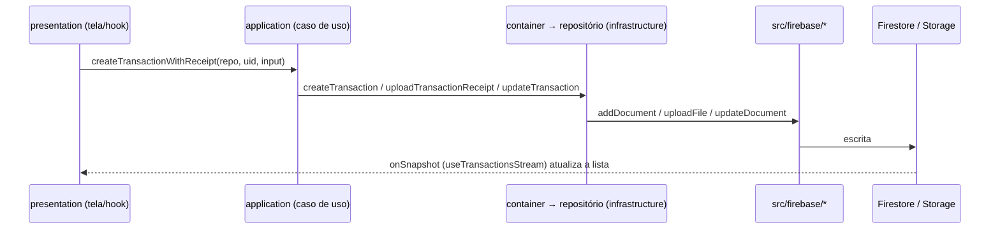

# Arquitetura — ByteBank Mobile

> App mobile (React Native + Expo SDK 58, Expo Router) do ByteBank: controle de transações
> financeiras com dashboard, comprovantes e perfil, usando Firebase (Auth, Firestore, Storage).
> Este documento é a visão geral (estrutura, navegação, dados, stack). A estrutura interna dos
> modules e as regras de dependência entre camadas estão em
> [`architecture/clean-architecture.md`](architecture/clean-architecture.md).

## Índice

1. [Visão geral](#1-visão-geral)
2. [Estrutura de pastas](#2-estrutura-de-pastas)
3. [Responsabilidade de cada diretório](#3-responsabilidade-de-cada-diretório)
4. [Providers e inicialização](#4-providers-e-inicialização)
5. [Autenticação e sessão](#5-autenticação-e-sessão)
6. [Navegação](#6-navegação)
7. [Fluxo de dados](#7-fluxo-de-dados)
8. [Modules (feature-based + Clean Architecture)](#8-modules-feature-based--clean-architecture)
9. [Componentes e design system](#9-componentes-e-design-system)
10. [Firebase: integração, modelo de dados e regras](#10-firebase-integração-modelo-de-dados-e-regras)
11. [Performance](#11-performance)
12. [Convenções](#12-convenções)
13. [Como criar uma nova funcionalidade](#13-como-criar-uma-nova-funcionalidade)
14. [Qualidade e testes](#14-qualidade-e-testes)
15. [Stack e decisões](#15-stack-e-decisões)

---

## 1. Visão geral

Arquitetura **feature-based** com **Clean Architecture dentro de cada feature**. Princípios:

- **`src/app/` é só roteamento.** Cada arquivo é uma casca fina que renderiza a tela de um module.
- **Modules não se acoplam.** Outros modules só importam o que está no `index.tsx` do module, e
  ele nunca exporta repositórios.
- **Telas não falam com o Firebase.** `presentation` acessa dados via `container.ts` (repositório)
  ou casos de uso; só `infrastructure/` e `AuthContext` usam `src/firebase/*`.
- **Estado de servidor ≠ estado de cliente.** Dados do Firestore ficam em React Query ou em
  assinaturas em tempo real (`onSnapshot`); Context API guarda sessão, tema, conectividade etc.
- **Estilização com NativeWind v4** (Tailwind), com tokens em `src/theme/`.
- **Camadas verificadas por lint** (`eslint-plugin-boundaries` em `eslint.config.js`).



---

## 2. Estrutura de pastas

```text
tech-challenge/
├── app.json, tsconfig.json, tailwind.config.js, babel.config.js, metro.config.js
├── eslint.config.js              # regras de camadas/entry-point
├── firebase.json, .firebaserc
├── firestore.rules, storage.rules # regras de segurança (fora do bundle)
├── docs/                          # esta documentação (+ performance/)
├── scripts/                       # start-emulator-web.mjs, reset-project.js
├── tests/                         # dashboard-period.test.mjs, firebase-emulator.test.mjs
├── assets/
└── src/
    ├── app/                       # Expo Router — só roteamento
    │   ├── _layout.tsx            # providers + auth guard + lock biométrico
    │   ├── +not-found.tsx
    │   ├── (auth)/                # login, register, forgot-password
    │   ├── (tabs)/                # index (Home), transactions, profile
    │   └── (modals)/              # new-transaction, edit-transaction, edit-avatar
    ├── modules/                   # features
    │   ├── auth/  home/  profile/  transactions/
    │   └── <feature>/{domain,application,infrastructure,presentation,container.ts,constants.ts,utils.ts,index.tsx}
    ├── components/                # UI sem domínio: ui/ feedback/ layout/ navigation/
    ├── layouts/                   # auth-layout, tab-screen-layout
    ├── contexts/                  # auth, theme, connectivity, notification, app
    ├── hooks/                     # use-debounce, use-network-status, use-app-state, use-color-scheme
    ├── services/                  # query-client, preload, storage (SecureStore), biometric
    ├── firebase/                  # config, auth, firestore, storage (únicos wrappers do SDK)
    ├── lib/                       # react-query (query keys), charts
    ├── utils/                     # funções puras: format-*, mask, cx, crypto, lazy-with-preload
    ├── constants/                 # routes, api, theme
    ├── config/                    # env.ts (validação das env vars), app-config.ts
    ├── types/                     # api, navigation, user
    ├── validations/               # common.schema.ts (schemas Zod compartilhados)
    ├── theme/                     # colors.js, spacing.js, typography.js (alimentam o tailwind.config.js)
    └── global.css                 # entrada do NativeWind
```

`assets/` fica na raiz por ser a convenção do Expo (`app.json` referencia `./assets/...`).

---

## 3. Responsabilidade de cada diretório

| Pasta | Responsabilidade |
|---|---|
| `src/app` | Define **onde** cada tela aparece (rotas, grupos, guards). Sem regra de negócio. |
| `src/modules` | Uma pasta por feature; contém domínio, casos de uso, infraestrutura e UI. |
| `src/components` | UI genérica sem conhecimento de domínio (`ui/`, `feedback/`, `layout/`, `navigation/`). |
| `src/layouts` | Composições estruturais reaproveitadas por várias rotas. |
| `src/contexts` | Estado de cliente global e de baixa frequência (sessão, tema, rede, notificações, flags). |
| `src/hooks` | Hooks genéricos, sem relação com uma feature. |
| `src/services` | Serviços transversais: `QueryClient`, pré-carregamento, `storage.service` (SecureStore/AsyncStorage), biometria. |
| `src/firebase` | Wrappers finos do SDK, por **operação** (não por domínio). |
| `src/lib` | Adaptação de libs de terceiros (query keys, charts). |
| `src/utils` | Funções puras (formatação, máscara, `cx`, criptografia de campos, `lazyWithPreload`). |
| `src/constants` | Valores fixos transversais (rotas nomeadas, API, tema). |
| `src/config` | Env vars tipadas/validadas e configuração do app. |
| `src/types`, `src/validations` | Tipos e schemas Zod usados por 2+ modules. |
| `src/theme` | Design tokens, fonte única do `tailwind.config.js`. |

---

## 4. Providers e inicialização

`src/app/_layout.tsx` monta, de fora para dentro:

```text
GestureHandlerRootView
└─ SafeAreaProvider
   └─ QueryClientProvider        (services/query-client.ts)
      └─ AuthProvider            (sessão, biometria)
         └─ TransactionsProvider (modules/transactions — assinatura em tempo real)
            └─ ThemeProvider
               └─ ConnectivityProvider
                  └─ NotificationProvider
                     └─ AppProvider
                        └─ RootNavigator
```

`RootNavigator` mantém a splash nativa até a sessão e as fontes (Ionicons) estarem prontas, exibe
`BiometricLockScreen` se o app estiver bloqueado e, com usuário autenticado, pré-carrega em
background os gráficos da Home.

| Context | Para quê |
|---|---|
| `AuthContext` | Usuário Firebase, `status` (`loading`/`authenticated`/`unauthenticated`), login/cadastro/logout, verificação de e-mail, lock biométrico. |
| `ThemeContext` | Claro/escuro, sincronizado com as classes `dark:` do NativeWind. |
| `ConnectivityContext` | Online/offline (`@react-native-community/netinfo`). |
| `NotificationContext` | Notificações/avisos in-app. |
| `AppContext` | Flags globais do app. |

---

## 5. Autenticação e sessão



1. `src/firebase/auth.ts` expõe `signIn`, `signUp`, `signOut`, `resetPassword`,
   `sendVerificationEmail`, `updateCurrentUserProfile`, `subscribeToAuthChanges` e mapeia erros
   para mensagens em português (`getAuthErrorMessage`).
2. `modules/auth` implementa `IAuthRepository` (`infrastructure/firebase/firebase-auth.repository.ts`),
   exposto por `container.ts`; hooks `use-login`, `use-register`, `use-forgot-password` consomem o
   repositório e os schemas de `domain/entities/auth.validation.ts` (Zod + react-hook-form).
3. `AuthContext` assina `subscribeToAuthChanges` uma vez e alimenta o guard do `_layout.tsx`
   (`Stack.Protected` com `redirectTo`).
4. **Persistência da sessão:** `services/storage.service.ts` guarda o estado do Firebase Auth no
   `expo-secure-store` (Keychain/Keystore, `WHEN_UNLOCKED_THIS_DEVICE_ONLY`), fatiando valores
   maiores que o limite de ~2 KB em vários chunks; `AsyncStorage` fica para preferências não sensíveis.
5. **Biometria:** `services/biometric.service.ts` (`expo-local-authentication`). Com o lock ativo,
   o app volta de background bloqueado; enquanto bloqueado, a assinatura de transações é
   encerrada.
6. **Limitação conhecida:** `AuthContext` usa `@/firebase/auth` diretamente e expõe o tipo `User` do Firebase.

---

## 6. Navegação

| Grupo | Telas | Observações |
|---|---|---|
| `(auth)` | `login`, `register`, `forgot-password` | Stack pública, sem tab bar. |
| `(tabs)` | `index` (Home), `transactions`, `profile` | `<Tabs>` com `tab-bar` customizado e `BottomTabItem`. |
| `(modals)` | `new-transaction`, `edit-transaction`, `edit-avatar` | Apresentados como modal; só para autenticados. |

- Rotas nomeadas em `src/constants/routes.ts` (`ROUTES.TABS.HOME`, `ROUTES.MODALS.*`...).
- O `TabsLayout` pré-carrega a Home imediatamente e Transações/Perfil em tempo ocioso
  (`preloadIdle`), além de reagir a `tabPress`.
- Arquivos em `src/app/**` devem ficar curtos (~15–20 linhas): importar a tela do module e renderizar.

```tsx
// src/app/(tabs)/transactions.tsx
import { TransactionsScreen } from '@/modules/transactions';
export default function Transactions() {
  return <TransactionsScreen />;
}
```

---

## 7. Fluxo de dados



- **Transações:** `TransactionsProvider` mantém uma assinatura em tempo real
  (`useTransactionsStream` → `subscribeToTransactions`), funcionando inclusive offline e com
  escritas de outros dispositivos; métricas via `calculateTransactionMetrics` (domain). A
  assinatura só existe com usuário logado e app desbloqueado.
- **Home/Perfil e demais leituras:** `@tanstack/react-query` (hooks `use-dashboard-summary`,
  `use-profile`...), com query keys por usuário/escopo (`lib/react-query.ts#createQueryKeys`).
  `staleTime` padrão 60 s, 2 retries, sem retry em `permission-denied`/`unauthenticated`,
  sem refetch ao focar a janela. Mutations invalidam as queries afetadas; troca/logout limpa o
  cache da sessão anterior. Dados financeiros não são persistidos em disco pelo React Query.
- **Formulários:** `react-hook-form` + `zodResolver`; schemas no `domain` do module.
- **Estado local de tela:** `useState`/`useReducer` no próprio componente.
- **Dado sensível:** `utils/crypto.ts` cifra no cliente campos como descrição e nome do comprovante
  (as regras do Firestore aceitam o payload cifrado).

---

## 8. Modules (feature-based + Clean Architecture)

```text
src/modules/<feature>/
├── domain/          entities/ rules/ services/ repositories/   # puro, sem React/Expo/Firebase
├── application/     casos de uso (só onde há orquestração)
├── infrastructure/  firebase/                                   # implementa os contratos
├── presentation/    components/ hooks/ context/
├── container.ts     # composition root (escolhe a implementação do repositório)
├── constants.ts     # query keys, opções de UI, paths de storage
├── utils.ts         # helpers de apresentação
└── index.tsx        # API pública
```

| Module | Responsabilidade | Destaques |
|---|---|---|
| `auth` | Login, cadastro, recuperação de senha, lock biométrico | `IAuthRepository`, validações Zod |
| `home` | Dashboard: saldo, estatísticas, gráficos, transações recentes | `dashboard-period.service` (filtro de período), `preloadHomeCharts`, gráficos lazy |
| `transactions` | CRUD de transações, filtros, paginação, comprovantes | `application/transaction.use-cases.ts`, `domain/rules/receipt.rules.ts`, `transaction-filter.service`, `transaction-metrics.service`, `TransactionsProvider` |
| `profile` | Dados do usuário e avatar | `IProfileRepository`, upload de avatar |

Regras de dependência, responsabilidades por camada e o passo a passo de criar transação com
comprovante estão em [`architecture/clean-architecture.md`](architecture/clean-architecture.md).

---

## 9. Componentes e design system

- **`ui/`**: `Avatar`, `Badge`, `BottomTabItem`, `Button`, `Card`, `DateField`, `Divider`, `Fab`,
  `Input`, `Modal`, `Pagination`, `Select`, `Typography`.
- **`feedback/`**: `Loading`, `Skeleton`, `EmptyState`.
- **`layout/`**: `ScreenContainer`, `Header`. **`navigation/`**: `tab-bar`.
- Regra anti-duplicação: componente genérico vive em `src/components`; só vira componente de
  module se for específico da feature. Se outra feature precisar, é **promovido**, nunca copiado.
- Estilos via classes NativeWind (`cx` para composição); `StyleSheet`/Reanimated só onde o
  Tailwind não cobre (animações, valores calculados).

---

## 10. Firebase: integração, modelo de dados e regras

```text
src/firebase/
├── config.ts     # initializeApp, emuladores (EXPO_PUBLIC_USE_FIREBASE_EMULATORS)
├── auth.ts       # operações de autenticação + mensagens de erro
├── firestore.ts  # getDocument, setDocument, addDocument, updateDocument, deleteDocument,
│                 # queryCollection, subscribeToDocument, subscribeToCollection
└── storage.ts    # uploadFile, getFileUrl, deleteFile + mensagens de erro
```

**Modelo de dados**

| Recurso | Caminho |
|---|---|
| Perfil | Firestore `users/{uid}` |
| Transação | Firestore `users/{uid}/transactions/{id}` (`description`, `amount`, `date`, `type` = Deposit/Transfer, `categories_id` 1–7, `receipt?`) |
| Comprovante | Storage `users/{uid}/transactions/{id}/receipts/{nome-único}` (JPEG/PNG/WebP/PDF) |
| Avatar | Storage `avatars/...` (JPEG/PNG/WebP; leitura para autenticados) |

**Segurança:** `firestore.rules` e `storage.rules` (raiz do projeto) restringem acesso ao próprio
`uid`, validam campos/tamanhos/tipos de conteúdo e negam todo o restante por padrão.
Env vars (`EXPO_PUBLIC_*`) são lidas e validadas em `src/config/env.ts`; modelo em `.env.example`.

**Regras de uso:** nenhuma tela/hook importa `firebase/*` ou `@/firebase/*`; wrappers expõem
operações genéricas, sem conhecimento de domínio; regras de negócio ficam em `domain`/`application`.

> Pré-requisito: o Firebase Storage precisa estar provisionado no console do projeto, ou os
> uploads (avatar e comprovantes) falham.

---

## 11. Performance

Detalhes em [`performance/performance-audit.md`](performance/performance-audit.md). Resumo:

- Gráficos pesados com `lazyWithPreload` (`utils/lazy-with-preload.ts`) e pré-carregamento na
  intenção de navegação (`tabPress`, `onPressIn`) e em tempo ocioso (`preloadIdle`).
- Imagens (avatar, comprovantes) pré-carregadas em cache `memory-disk` via
  `services/preload.service.ts` (`expo-image`).
- Cada module de tab expõe `preload*Module` (ex.: `preloadTransactionsModule`).
- Splash nativa mantida até sessão e fontes resolvidas.

---

## 12. Convenções

| Item | Convenção | Exemplo |
|---|---|---|
| Arquivos | `kebab-case` | `transaction-form.tsx` |
| Componentes | `PascalCase` | `TransactionForm` |
| Hooks | `use` + camelCase | `useCreateTransaction` |
| Providers/Contexts | `XContext` / `XProvider` | `AuthProvider` |
| Rotas | `[param].tsx`, grupos `(nome)` | `(tabs)` |
| Tipos | `PascalCase`, sem prefixo `I` (exceto contratos de repositório) | `Transaction`, `ITransactionRepository` |
| Schemas Zod | camelCase + `Schema` | `transactionFormSchema` |
| Constantes | `SCREAMING_SNAKE_CASE`; objetos em camelCase | `ROUTES`, `TRANSACTIONS_QUERY_KEYS` |
| Arquivos de camada | sufixos `.entity`, `.repository`, `.service`, `.rules`, `.use-cases`, `.validation` | `receipt.rules.ts` |
| Barrel do module | `index.tsx` | `modules/home/index.tsx` |

Boas práticas: sem `console.log` com dados sensíveis; tokens só em SecureStore; validação de
formulário sempre com Zod; dados de servidor nunca copiados para `useState`; Context só para
estado global de baixa frequência.

---

## 13. Como criar uma nova funcionalidade

1. Criar `src/modules/<feature>/` com `domain/` (entidades, schemas Zod, `repositories/` com a interface).
2. Implementar o repositório em `infrastructure/firebase/` usando `@/firebase/*`.
3. Expor a implementação em `container.ts`.
4. Se houver mais de uma chamada ao repositório, criar o caso de uso em `application/`.
5. Criar `presentation/hooks` (React Query/Context) e `presentation/components` (usando `src/components/ui`).
6. Exportar a tela (e o necessário) em `index.tsx` — sem exportar repositórios.
7. Criar a rota fina em `src/app/(tabs|modals)/...` e registrar em `src/constants/routes.ts`;
   se for tab, adicionar o `Tabs.Screen` em `(tabs)/_layout.tsx`.
8. Se envolver dados novos, atualizar `firestore.rules`/`storage.rules` e `tests/firebase-emulator.test.mjs`.
9. Rodar `npx tsc --noEmit` e `npx expo lint`.

---

## 14. Qualidade e testes

- **Tipagem:** `npx tsc --noEmit` (TypeScript 6).
- **Lint/camadas:** `npx expo lint` (ESLint 9 + `eslint-plugin-boundaries`: camadas e entry-point).
- **Testes:** `npm run test:dashboard` (período do dashboard, `node --test`) e
  `npm run test:emulators` (regras e fluxos contra Auth/Firestore/Storage Emulators, projeto `demo-tech-challenge`).
- **Desenvolvimento local:** `npm run emulators` e `npm run start:emulator-web`.

---

## 15. Stack e decisões

| Área | Escolha | Motivo |
|---|---|---|
| Framework | Expo SDK 58, React Native 0.88, React 19 | Base do projeto; consultar a doc versionada do Expo antes de codar (ver `AGENTS.md`). |
| Navegação | Expo Router (`Stack.Protected`, grupos) | Rotas por arquivo, guards declarativos. |
| Estilo | NativeWind 4 + Tailwind 3 | Compila para `StyleSheet`; mesma linguagem do ByteBank web; tokens em `src/theme`. |
| Estado de servidor | `@tanstack/react-query` + `onSnapshot` | Cache/retry prontos; tempo real para transações. |
| Formulários | `react-hook-form` + `zod` + `@hookform/resolvers` | Validação tipada e reutilizável no domínio. |
| Backend | Firebase 12 (Auth, Firestore, Storage) | Auth + dados por usuário + comprovantes. |
| Segurança local | `expo-secure-store`, `expo-local-authentication` | Sessão no Keychain/Keystore e lock biométrico. |
| Gráficos | `react-native-gifted-charts` + `react-native-svg` | Dashboard sem Skia. |
| Animação | Reanimated 4 + Worklets + Gesture Handler | Animações em UI thread. |
| Datas/máscaras | `date-fns`, `react-native-mask-input` | Formatação e entrada de valores/datas. |
| Mídia | `expo-image`, `expo-image-picker`, `expo-document-picker` | Cache de imagens e anexos (imagem/PDF). |

Fora do escopo atual: Zustand, MMKV, Sentry e Jest/Testing Library — avaliar se o app crescer.
